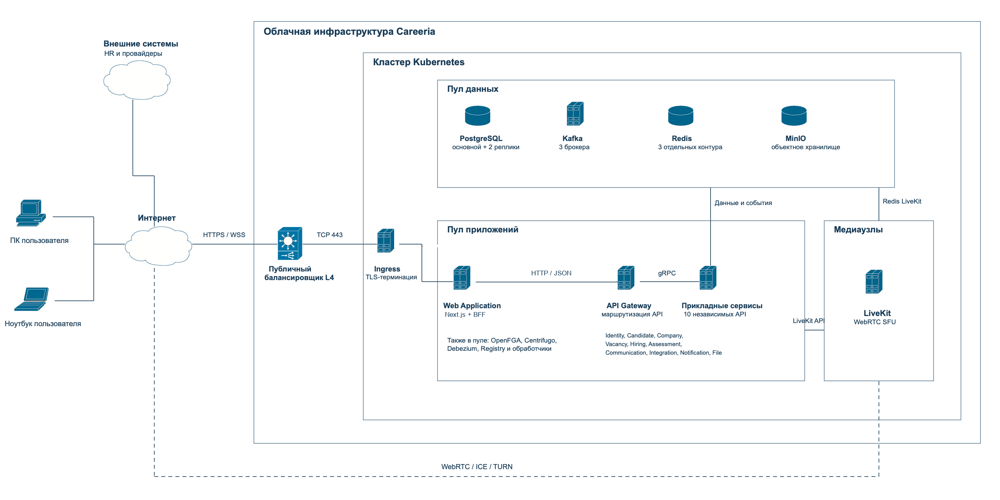

# 4.3. Сетевая архитектура программного обеспечения

Сетевая архитектура определяет размещение технических средств Careeria и взаимодействие компонентов платформы. Инфраструктура включает пользовательские устройства, пограничный контур, вычислительные узлы приложений, средства хранения данных и медиаузлы.

## 4.3.1. Структурная схема комплекса технических средств

Рисунок 4.3.1 - Структурная схема комплекса технических средств Careeria

Схема показывает группы узлов и основные сетевые маршруты. Один условный сервер внутри группы не обозначает одну реплику приложения или отдельный физический компьютер для каждого сервиса. Линии показывают основные сетевые пути; направления запросов и протоколы приведены в таблице ниже. Внутри пула приложений Web Application (Next.js с серверным BFF) обращается к API Gateway, который передаёт запросы прикладным сервисам; Ingress направляет страницы и запросы к BFF в одно Next.js-приложение. Линия к пулу данных обобщает соединения разных сервисов и не означает, что каждый сервис обращается ко всем хранилищам. Значок Redis объединяет три независимых контура Identity, Centrifugo и LiveKit. Вызовы между отдельными микросервисами здесь не раскрываются.

Пользовательский запрос из браузера проходит через Интернет, публичный L4-балансировщик и Ingress в Next.js. Серверный BFF передаёт его в API Gateway, который обращается к нужному сервису. Для событийных и медийных взаимодействий используются отдельные пути. Средства сетевой защиты и параметры подключения определяются при размещении инфраструктуры.

## 4.3.2. Краткая аннотация состава комплекса технических средств

В состав комплекса входят пользовательские устройства, сетевые средства и вычислительные узлы облачной инфраструктуры. Ниже приведена стартовая проектная конфигурация. Параметры процессоров, памяти и дисков указаны как предварительный ориентир на один узел, а не как характеристики выбранного оборудования; их необходимо уточнить после нагрузочного расчёта. Модели оборудования и облачный провайдер пока не выбраны.

Рабочие места пользователей

- Состав: персональные компьютеры, ноутбуки и мобильные устройства с доступом в Интернет.
- Программное обеспечение: браузер с поддержкой HTTPS, WebSocket и WebRTC.
- Дополнительное оборудование: камера, микрофон и устройства воспроизведения звука для онлайн-собеседований.
- Модели устройств и минимальные системные требования: определяются отдельно.

Сетевые средства и пограничный контур

- Публичный балансировщик: L4, передача TCP-трафика на порт 443 к Ingress.
- Ingress Controller: завершение TLS и маршрутизация запросов к Web Application, API Gateway, Centrifugo, LiveKit и разрешённому S3 endpoint.
- Внешние протоколы: HTTPS и WSS; медиатрафик WebRTC передаётся отдельным маршрутом.
- Модель сетевого оборудования, пропускная способность и средства защиты: определяются при выборе провайдера и проектировании сети.

Вычислительные узлы приложений

- Количество: от трёх worker-узлов Kubernetes с возможностью расширения пула.
- Предварительный ориентир на узел: 8 vCPU, 32 ГБ оперативной памяти, 100 ГБ дискового пространства для ОС и системных компонентов.
- Операционная система и платформа: Linux и Kubernetes; конкретный дистрибутив и версии определяются отдельно.
- Размещаемое ПО: Web Application на Next.js с серверным BFF, API Gateway, прикладные сервисы и фоновые обработчики, OpenFGA, Centrifugo, Schema Registry и Debezium/Kafka Connect.
- Web Application и API Gateway имеют отдельные развёртывания; BFF запускается и масштабируется вместе с Next.js.

Вычислительные узлы и средства хранения данных

- Количество: от трёх выделенных worker-узлов Kubernetes; для MinIO могут потребоваться дополнительные узлы.
- Предварительный ориентир на узел: 8 vCPU и 32 ГБ оперативной памяти. Объём и производительность постоянных дисков определяются по объёму данных, нагрузке и выбранной топологии хранения.
- Операционная система и платформа: Linux, Kubernetes и постоянные тома для stateful-компонентов.
- СУБД PostgreSQL: один основной экземпляр и две реплики, отдельный постоянный том для каждого экземпляра; данные сервисов разделяются логическими базами и ролями.
- Брокер сообщений Kafka: три экземпляра с KRaft и постоянными томами.
- Redis: раздельные контуры для Identity, Centrifugo и LiveKit; конфигурация отказоустойчивости определяется для каждого контура.
- Объектное хранилище MinIO: S3-совместимое хранение файлов; число узлов, дисков и схема размещения выбираются отдельно.

Медиаузлы

- Количество: от двух выделенных worker-узлов Kubernetes.
- Предварительный ориентир на узел: 8 vCPU, 16 ГБ оперативной памяти и 100 ГБ дискового пространства для ОС и системных компонентов.
- ПО: Linux, Kubernetes и LiveKit для аудио- и видеосвязи.
- Размещение: host networking, не более одного Pod LiveKit на узел. Требуемые CPU и пропускная способность сети уточняются по числу одновременных комнат и участников.

Внешние системы и сервисы

- HR-системы: обмен webhook с Integration Service.
- Провайдеры уведомлений: доставка сообщений по предусмотренным каналам.
- Размещение, модели оборудования и характеристики внешних систем определяются их владельцами.

## 4.3.3. Спецификация протоколов и API взаимодействия компонентов

Спецификация устанавливает требования к взаимодействию пользователей, сервисов и внешних систем. Контракты прикладного API платформы описываются в Protocol Buffers: сервисы, операции, запросы, ответы, типы данных, ошибки и правила проверки. Для каждого пользовательского и межсервисного сценария определяется соответствующая операция. Состав операций и поля сообщений определяются контрактами соответствующих сервисов.

### 4.3.3.1. Правила описания контрактов

- Для внутренних синхронных вызовов используются gRPC, HTTP/2 и сообщения Protobuf. Внешний HTTP/JSON API публикуется через API Gateway с использованием grpc-gateway. Серверный BFF Next.js обрабатывает сессию и обращается к шлюзу.
- В `.proto` для публичных HTTP-операций задаются `google.api.http`, методы, маршруты и отображение тела запроса. OpenAPI-описание и клиенты формируются из контрактов.
- В protobuf options задаются политика аутентификации операции, требования авторизации, правила проверки полей и документация. Для доступных через MCP операций задаются дополнительные options с описанием инструмента, входных параметров и ограничений доступа. Публикация операции через MCP не отменяет проверки прав.
- Для запросов и ответов фиксируются обязательность полей, идентификаторы, форматы дат и денег, ограничения, постраничная выдача и единый формат ошибок. Для изменяющих операций определяются права, идемпотентность и правила разрешения конфликтов версий.
- Личность пользователя и компании передаётся из доверенного контекста после проверки; вызывающие сервисы также аутентифицируются. Публичные методы и методы, требующие сессии или токена, различаются политикой аутентификации.
- Доменные события описываются версионируемыми Avro-схемами в Schema Registry. HTTP webhook внешних систем, OAuth/OIDC, S3 API, WebSocket и WebRTC используют свои форматы и протоколы; прикладные операции управления ими также описываются в Protobuf.

### 4.3.3.2. Взаимодействие внутренних компонентов

Таблица 4.3.1 - Взаимодействие внутренних компонентов

| Компонент | Исходящие данные и получатель | Входящие данные и отправитель | Протокол и формат |
|---|---|---|---|
| Web Application и BFF | Авторизованные запросы к API Gateway; подписка на realtime; запросы на загрузку и скачивание файлов | Запросы браузера, ответы API и события | HTTPS и JSON; WebSocket; S3 API по временной ссылке |
| API Gateway | Вызовы прикладных сервисов, проверка identity | HTTP-запросы BFF и разрешённых внешних клиентов; ответы сервисов | HTTP/JSON, gRPC/Protobuf |
| Identity | Контекст пользователя и сессии, токены и события identity | Регистрация, аутентификация, управление сессией и OAuth-запросы | gRPC/Protobuf, OAuth 2.0 и OIDC, HTTP/JSON |
| Candidate | Профили, резюме и снимок данных для Hiring; запросы файлов в File Service | Команды и запросы профилей и резюме | gRPC/Protobuf; доменные события Avro |
| Company | Данные компаний, участников и ролей; события изменений | Команды управления компанией, приглашениями и участниками | gRPC/Protobuf; события Avro |
| Vacancy | Карточки и состояние вакансий; события публикации и закрытия | Управление и поиск вакансий; запросы из Hiring | gRPC/Protobuf; события Avro |
| Hiring | Отклики, этапы, интервью и офферы; обращения к Candidate, Vacancy, File и LiveKit | Команды участников, результаты оценки и события интеграции | gRPC/Protobuf; события Avro; LiveKit API |
| Assessment | Шаблоны, назначения, решения и результаты; задачи проверки | Команды кандидатов и интервьюеров, запросы Hiring, результаты Runner | gRPC/Protobuf; события Avro; API среды выполнения |
| Communication | Диалоги, сообщения и вложения; запросы File Service; события сообщений | Команды участников и события контекста найма | gRPC/Protobuf; события Avro |
| Notification | Задачи уведомлений, inbox и сообщения провайдерам | Команды сервисов и доменные события | gRPC/Protobuf; Kafka/Avro; API провайдеров |
| Integration | Нормализованные события и исходящие доставки | Управление подключениями, внешние webhook и доменные события | gRPC/Protobuf; HTTPS/JSON; Kafka/Avro |
| File | Метаданные и состояние файла, ограниченные ссылки и привязки; операции с MinIO | Команды доменных сервисов, результат проверки файла | gRPC/Protobuf; S3 API |
| OpenFGA и синхронизация прав | Результаты проверок, обновления отношений доступа | Запросы авторизации и доменные события | OpenFGA API; Kafka/Avro |
| PostgreSQL, Debezium и Kafka | Данные и записи outbox; публикация и доставка событий | SQL-запросы сервисов и чтение журнала изменений | SQL, PostgreSQL WAL, Kafka и Avro |
| Realtime Publisher и Centrifugo | События в пользовательские каналы | Доменные события и подписки авторизованных клиентов | Kafka/Avro; Centrifugo API и WebSocket |
| LiveKit | Аудио, видео и события комнат | Команды управления комнатами и подключения участников | LiveKit API; WebRTC, HTTPS и WSS |

### 4.3.3.3. Взаимодействие с внешними ресурсами

Таблица 4.3.2 - Взаимодействие с внешними ресурсами

| Внешняя система | Тип данных | Формат и протокол | Безопасность |
|---|---|---|---|
| Браузер пользователя | Страницы, команды, результаты, события и файлы | HTTPS/JSON, WebSocket, WebRTC, S3 API | TLS, HttpOnly/Secure/SameSite cookie, проверка сессии и CSRF, права на ресурсы |
| Внешний OAuth/OIDC-клиент и Identity Provider | Авторизационные запросы, токены, сведения о пользователе и ключи | OAuth 2.0, OIDC, HTTPS, JSON и JWT | Проверка клиента, redirect URI, state, PKCE, подписи и срока действия токенов |
| HR-система работодателя | Настройки интеграции, события найма и входящие и исходящие webhook | HTTPS/JSON | Подпись и проверка подлинности запроса, ограничение времени действия, изоляция компании и дедупликация |
| Провайдеры email, push и SMS | Адрес доставки, шаблон и содержимое уведомления; статус отправки | HTTPS и API соответствующего провайдера | TLS, секреты интеграции, ограничение доступа и защита персональных данных |
| Внешняя среда проверки решений | Решения, задания, статус исполнения и результаты проверки | API среды выполнения и согласованный формат данных | Аутентификация вызовов, изоляция выполнения, ограничения ресурсов и защита скрытых тестов |
| Внешние MCP-клиенты | Описание инструментов, параметры операций и результаты | MCP и согласованный транспорт; JSON | Аутентификация клиента, авторизация каждой операции и проверка аргументов |

Маршруты, поля и права внешних вызовов определяются контрактом конкретного ресурса. Временные ссылки на файлы ограничиваются операцией и сроком действия; медиа передаётся непосредственно через LiveKit по отдельному сетевому маршруту.
